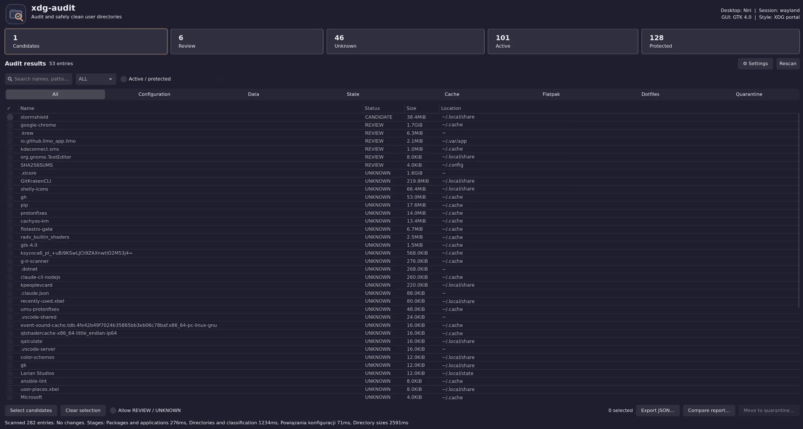
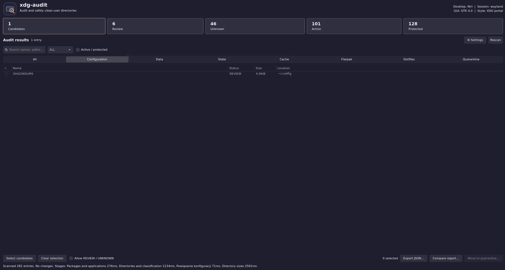
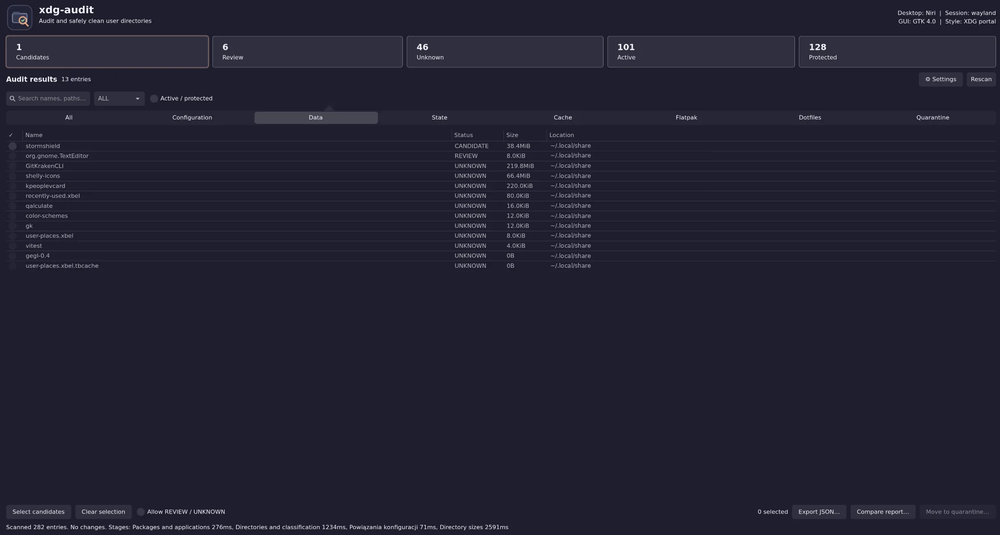
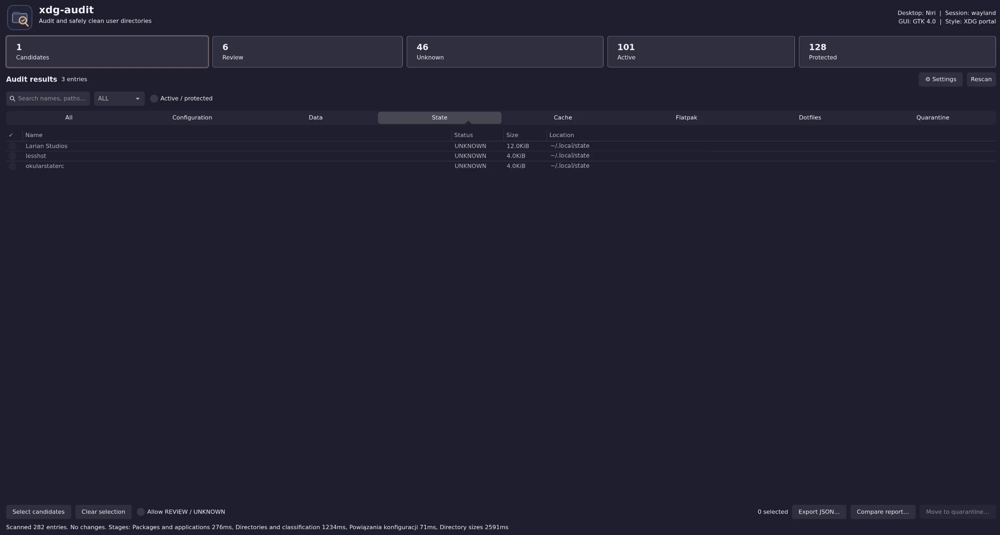
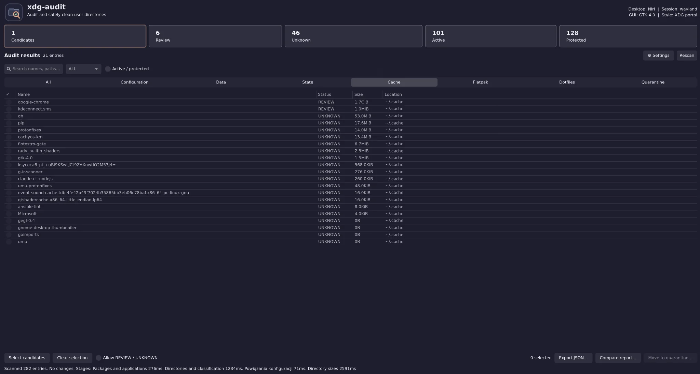
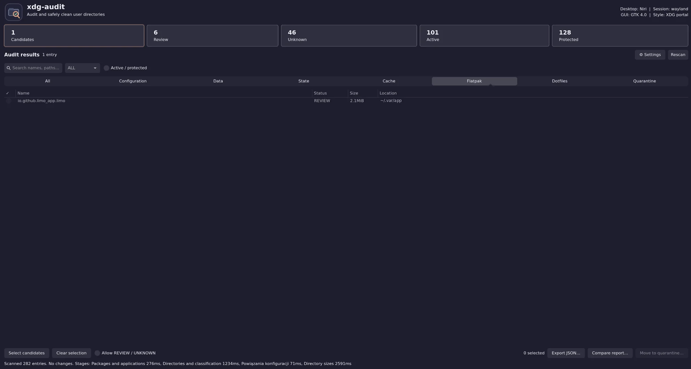
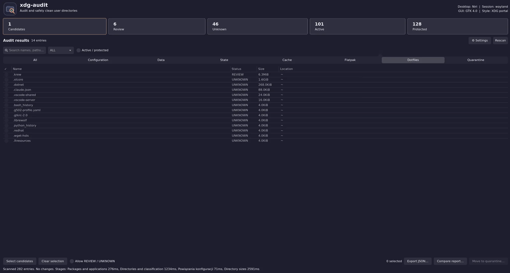
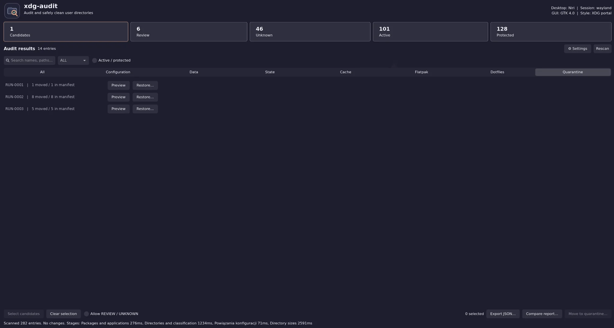
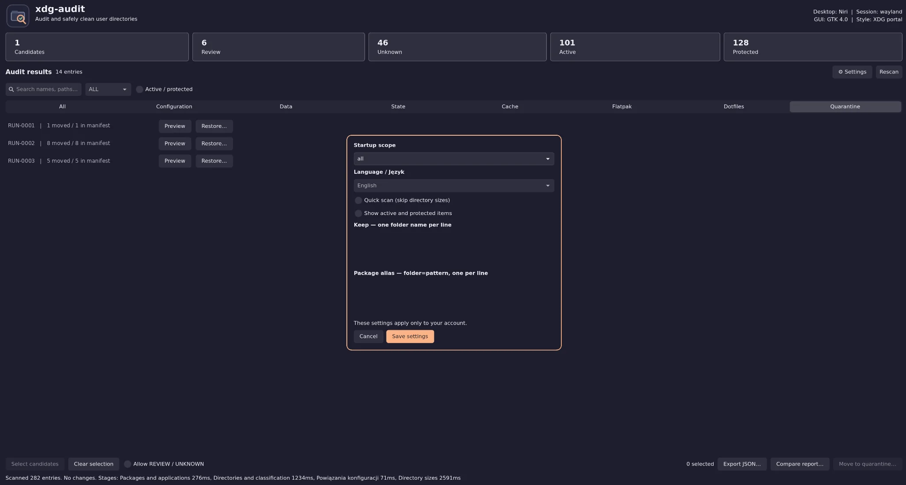

<p align="center">
  
</p>

<h1 align="center">xdg-audit</h1>
<p align="center"><strong>Find leftover Linux application files. Keep control of your data.</strong></p>
<p align="center">Read-only by default · Recoverable quarantine · Native GTK / Qt / Tk desktop UI</p>

<p align="center">
  <a href="https://github.com/ultherego/xdg-audit/actions/workflows/tests.yml"></a>
  <a href="https://github.com/ultherego/xdg-audit/releases"></a>
  
  
  
</p>

xdg-audit scans user-scoped configuration, data, state, cache, Flatpak directories and selected dotfiles. It highlights **possible leftovers** while distinguishing active, protected and uncertain application data. **Nothing is deleted automatically.**

## 🖥️ Preview

<details>
<summary><strong>🔎 Overview</strong> — click the screenshot to expand inside this README


</summary>


</details>

<details>
<summary><strong>📸 Browse all 8 other screenshots</strong> — click any thumbnail to expand it below</summary>

<details>
<summary><strong>Configuration</strong> — View configuration leftovers · click to enlarge


</summary>


</details>

<details>
<summary><strong>Data</strong> — Review application data · click to enlarge


</summary>


</details>

<details>
<summary><strong>State</strong> — Inspect state directories · click to enlarge


</summary>


</details>

<details>
<summary><strong>Cache</strong> — Inspect caches · click to enlarge


</summary>


</details>

<details>
<summary><strong>Flatpak</strong> — Review Flatpak application data · click to enlarge


</summary>


</details>

<details>
<summary><strong>Dotfiles</strong> — Inspect selected home-level entries · click to enlarge


</summary>


</details>

<details>
<summary><strong>Quarantine</strong> — Preview and restore quarantined entries · click to enlarge


</summary>


</details>

<details>
<summary><strong>Settings</strong> — Choose scan scope, language and keep rules · click to enlarge


</summary>


</details>

</details>

<sub>Screenshots: GTK4 on Niri / Wayland. User paths are replaced with neutral, illustrative paths; pointer and individual quarantine run identifiers have been removed. These are real application screens, not UI mock-ups.</sub>

## ✨ Features

| | Capability | Details |
|:--:|---|---|
| 🔍 | **Evidence-based audit** | `CANDIDATE`, `REVIEW`, `UNKNOWN`, `ACTIVE`, `PROTECTED` with explanations and package/process evidence |
| 🛡️ | **Safety-first cleanup** | Explicit selection, protected data, fail-closed inventory checks, no-overwrite moves |
| ♻️ | **Recoverable quarantine** | Manifest-backed moves and restores, inode/device/type verification for new manifests |
| 🖥️ | **Native interfaces** | GTK4/GTK3, Qt6 and Tk; automatically chooses an already installed backend |
| 🌐 | **English & Polish** | Change UI language without rescanning |
| 📂 | **Focused workflow** | Scope tabs, search, sorting, quick scan, progress, cancellation and directory sizes |
| 📊 | **Portable reports** | JSON export and comparison against a prior audit |
| 🧩 | **Personal controls** | Keep rules and app/package aliases |

## 🚀 Get started

**Linux + Python 3.10+**. The command-line engine uses the Python standard library. There is no `pip install` step or automatic dependency installer.

```bash
git clone https://github.com/ultherego/xdg-audit.git
cd xdg-audit
python3 xdg_audit.py
```

The command launches an available GUI backend. To scan read-only in a terminal:

```bash
python3 xdg_audit.py --scope all
```

### 🧰 Native GUI backends

Install **one** backend using your distribution's package manager (Arch Linux / CachyOS names):

| GUI | Packages |
|---|---|
| GTK4 (Niri, GNOME) | `python-gobject gtk4` |
| GTK3 fallback | `python-gobject gtk3` |
| Qt6 (KDE Plasma, LXQt) | `pyside6` **or** `python-pyqt6` |
| Tk (X11 / XWayland fallback) | `tk` |

```bash
# GTK4
sudo pacman -S --needed python python-gobject gtk4

# Or Qt6
sudo pacman -S --needed python pyside6
```

**System tools:** `coreutils` (`du`) for directory sizes, `procps-ng` (`ps`) for process evidence. `pacman` verifies installed packages on Arch/CachyOS and is **required before quarantine moves** (fail closed if the inventory cannot be verified). Optional integrations: `flatpak`, `snap`, `systemctl --user`, and `xdg-open`.

### Wykrywanie źródeł instalacji aplikacji

To dotyczy tego, **jak zainstalowane zostały audytowane aplikacje**,
a nie metody instalacji samego xdg-audit.

```fish
python3 xdg_audit.py --installed-sources
```

Zestawienie tylko do odczytu pokazuje stan inwentarzy pacman, pacman-foreign,
Flatpak, Snap, AppImage, zainstalowanych pakietów DEB/RPM i ochronnych wskazówek dla ręcznie instalowanych
binarek (`~/.local/bin`, `~/bin`, `/usr/local/bin`, `/opt`).
Pakiety foreign mogą pochodzić z AUR **lub** lokalnej instalacji.
Błąd aktywnego dostawcy nie oznacza odinstalowania programu i blokuje MOVE
do czasu poprawnego ponownego sprawdzenia. Odczyt `dpkg-query` i `rpm -qa` służy obecnie do ochrony
**zainstalowanych** aplikacji. MOVE na systemach Debian/RPM pozostaje
zablokowany do czasu walidacji właściwego dostawcy pakietów przed zmianami;
obecnie MOVE nadal wymaga sprawnego pacmana.


## 🛡️ Safety model

| Status | Meaning |
|---|---|
| `CANDIDATE` | Possible leftover — **not a guarantee of safe removal** |
| `REVIEW` / `UNKNOWN` | Uncertain ownership; additional manual confirmation is required |
| `ACTIVE` / `PROTECTED` | Cannot be moved to quarantine |

- Scans do not modify data. The user must explicitly select and confirm every move.
- With `--remove`, selected entries are **moved, not permanently deleted**, into `~/.local/share/xdg-audit-quarantine/`.
- Before a move the application revalidates filesystem and package evidence, refuses cross-filesystem moves, and never overwrites the destination.
- New v3 manifests bind restores to the original device, inode and file type and include a recursive SHA-256 inventory for later verified purge. Earlier manifests remain restore-capable; old v3 runs require explicit inventory adoption before purge.
- Cancelled and unfinished scans cannot authorize quarantine operations.
- Permanent deletion (`PURGE`) requires its own explicit confirmation and strict recursive verification; automatic retention is disabled unless opted into.

> [!CAUTION]
> File ownership is inherently ambiguous. Inspect each candidate and keep backups of anything important. Quarantine is **not** a replacement for a backup.

## ⌨️ CLI

```bash
python3 xdg_audit.py --help
python3 xdg_audit.py --scope config --json > audit.json
python3 xdg_audit.py --scope config --compare audit.json
python3 xdg_audit.py --scope config --remove  # Interactive confirmation
python3 xdg_audit.py --list-quarantine
python3 xdg_audit.py --restore RUN_ID         # Interactive confirmation
python3 xdg_audit.py --quarantine-info RUN_ID
python3 xdg_audit.py --purge RUN_ID --dry-run
python3 xdg_audit.py --purge RUN_ID           # Explicit PURGE confirmation
python3 xdg_audit.py --purge-expired          # Retention preview
python3 xdg_audit.py --cleanup-history RUN_ID --dry-run
python3 xdg_audit.py --cleanup-expired-history # 30 days after PURGE
python3 xdg_audit.py --cleanup-all-history    # Preview all completed history
python3 xdg_audit.py --cleanup-all-history --execute # Explicit HISTORY confirmation
python3 xdg_audit.py --polkit-test-status      # Read-only existing Polkit check
python3 xdg_audit.py --polkit-test-auth        # AUTH + native Polkit id -u
python3 xdg_audit.py --polkit-test-create      # TEST: create ~/.config fixture
python3 xdg_audit.py --polkit-test-repair      # ACCESS TEST: owner-only repair
python3 xdg_audit.py --polkit-test-delete      # DELETE TEST: clean test-only fixture
```

Available scopes: `all`, `config`, `data`, `state`, `cache`, `flatpak`, `dotfiles`.

Completed PURGE operations remain visible in the GUI as **PURGED** until
their manifest is cleaned up; that history may be automatically removed 30
days after full PURGE, but only with explicit opt-in to automatic retention.
Incomplete or corrupted journals are never auto-removed.

**Normal operation:** In GTK, Qt and Tk, **Usuń trwale…** checks the
quarantine and, when needed, automatically opens **Sprawdź dostęp…**.
For user-owned files/directories with restricted permissions it offers
an individually confirmed `ACCESS` change. If the original inventory was
unsealed, it then requires separate `ADOPT` confirmation, followed by a
fresh preflight and the usual independent `PURGE` confirmation.

For advanced/manual checks, the **CLI** still offers isolated, optional
Polkit and ~/.config test fixtures (see
[Polkit and access self-tests](docs/polkit-selftest.md)). These test controls
are intentionally **not present in the GUI**. Polkit does not elevate
quarantine operations: root-owned files remain blocked until a separately
audited and packaged privileged helper is available.

See [Quarantine lifecycle](docs/quarantine-lifecycle.md) for recovery,
history-only cleanup, manual/automatic retention, user-scoped systemd
timer, legacy adoption, and safeguards.

## 🧭 Kolejne etapy projektu

Najpierw domykamy bezpieczeństwo i jakość wersji 1.7.0 — bez zmiany
reguł kwalifikowania osieroconych danych. Zobacz
[release-readiness checklist](docs/release-readiness.md).

Następny etap będzie dotyczył **wykrywania źródeł instalacji aplikacji**,
a nie pakowania samego xdg-audit:
AUR/pakiety foreign, binarki instalowane ręcznie, dokładniejszy Flatpak,
Snap i AppImage, a później inwentarze `dpkg` i `rpm`.
Aktualnie AUR instalowany za pomocą pacmana jest już widoczny jako
zainstalowany pakiet. Szczegółowy plan i ograniczenia bezpieczeństwa:
[installation-source-support](docs/installation-source-support.md).

## 🧪 Testing & release status

The unreleased development version on `main` is **`1.7.0-rc2`**. The most recent tagged prerelease is **[v1.7.0-rc1](https://github.com/ultherego/xdg-audit/releases/tag/v1.7.0-rc1)**.

GitHub Actions runs Python 3.10–3.14 tests, GTK4/Qt6/Tk GUI startup under Xvfb, native GTK4/Qt6 Wayland startup with headless Weston, a synthetic benchmark, the isolated end-to-end quarantine/restore/purge test, and source ZIP/tar.gz integrity checks. **Real-session Niri and KDE Plasma usage still deserves separate validation before a stable release.**

```bash
python3 -m unittest discover -s tests -v
python3 scripts/smoke_quarantine_cycle.py
python3 scripts/build_archives.py --output-dir dist
```

The quarantine test creates a disposable `HOME`, performs real moves, restores and purge, verifies file hashes and handles simulated conflicts without writing into your real XDG directories. Details: [Safe integration testing](docs/testing-quarantine.md).

Desktop-menu installation and distribution packaging are intentionally deferred. See the [changelog](CHANGELOG.md) for version history.